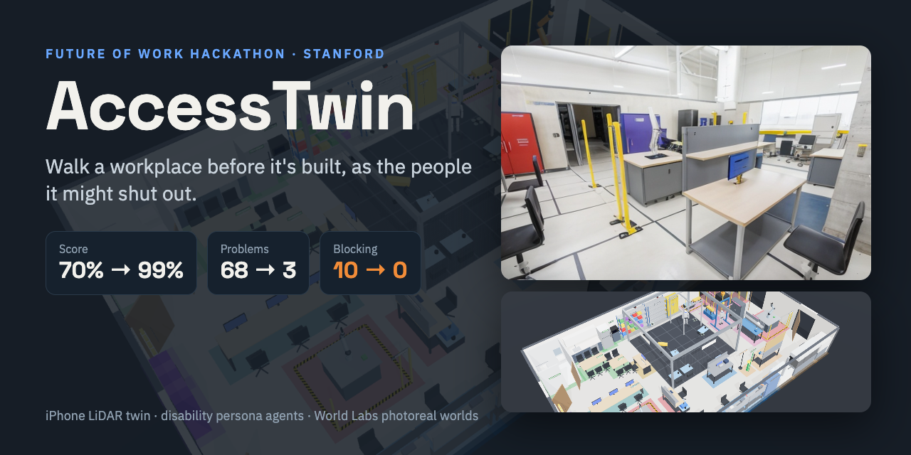

# AccessTwin



Walk a workplace before it is built, as the people it might shut out.
Track 1 (Accessible Workplace Twin), Future of Work Hackathon @ Stanford.

**Demo site and video: https://bouncypitch.github.io/accesstwin/**

A 2-minute iPhone scan becomes a metric digital twin. A research agent builds a cited program for the new use (here: a
robotics lab), a design agent lays it out, and four persona agents (wheelchair user, low vision / color-blind,
neurodivergent worker, robot motion clearance) walk real routes through it, flag every problem with the rule it breaks,
and a remediation agent fixes the design. On the hackathon venue: **70% → 99% accessibility score, 68 → 3 problems,
10 → 0 blocking**.

**SpaceSpec** (`accesstwin/spec.py`) is the source of truth: a measured scene graph in meters. Every check runs on it
as geometry, with a citation. Generative models (Stable Diffusion + ControlNet, World Labs Marble) are used only to make
it look real.

## Pipeline

| Step | Code | Output |
|---|---|---|
| Scan (RoomPlan + RGB-D walkthrough) | `ios/`, `accesstwin/roomplan.py`, `accesstwin/rgbd.py` | `demo/assets/01_scan_venue`, `02_rgbd_venue` |
| Empty the room (people, furniture) | `scripts/empty_venue.py` | 360° panorama, flagged point cloud |
| Research the program | `knowledge/robotics_lab.json` | zones, equipment, cited requirements |
| Design A | `scripts/make_design_a.py` | `specs/design_a.json` |
| Persona agents | `accesstwin/agents/` | cited findings (`accesstwin audit`) |
| Remediation → Design B | `accesstwin/remediate.py`, `scripts/make_design_b.py` | `specs/design_b.json`, change log |
| 3D twin | `viewer/twin.html`, `scripts/build_viewer.py` | interactive three.js twin |
| Photoreal worlds | `scripts/photoreal_stops.py`, `tools/photoreal/photoreal.py`, `scripts/stop_worlds.py` | ControlNet frames → Marble worlds |
| Story video | `scripts/make_story.py`, `viewer/director.js`, `recorder/record.mjs` | narrated MP4 |
| Demo site | `scripts/build_site.py` | `demo/site/index.html` |

## Run

```shell
uv sync
uv run accesstwin audit specs/design_a.json      # audit Design A with all four agents
uv run python scripts/make_design_b.py           # remediate -> Design B
uv run python scripts/build_viewer.py            # 3D twin -> out/03_design/twin.html
uv run pytest -q
```
